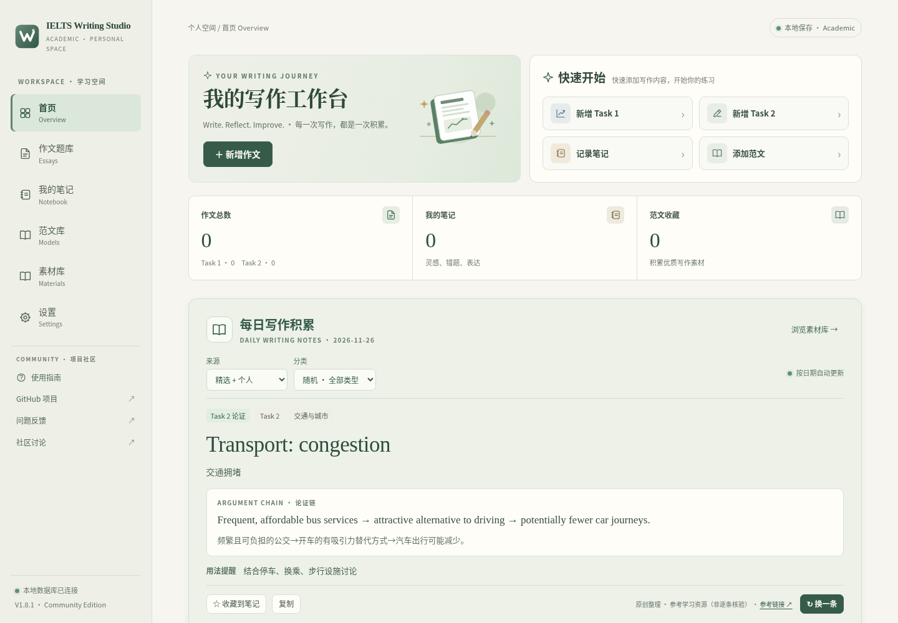
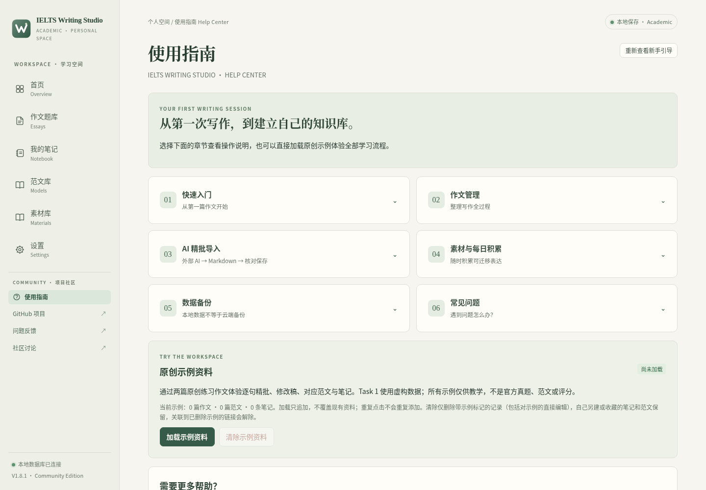
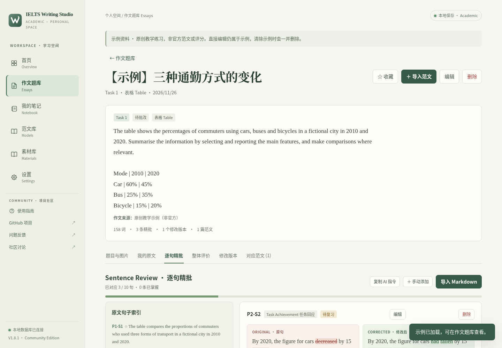

# IELTS Writing Studio · 雅思写作工作台

**Write. Reflect. Improve.**  
每一次写作，都是一次积累。

一个免费的、本地优先的 IELTS Academic 写作学习空间。  
A free, local-first workspace for IELTS Academic writing practice and language learning.

`v1.8.1-beta` · `Public Beta` · `Local-first` · `No Login`

**[在线体验 · Live Demo](https://2b9zmbnpsh-afk.github.io/ielts-writing-studio/)** &nbsp;|&nbsp; **[下载离线版 · Download](https://github.com/2b9zmbnpsh-afk/ielts-writing-studio/releases)** &nbsp;|&nbsp; [版本发布 · Releases](https://github.com/2b9zmbnpsh-afk/ielts-writing-studio/releases)

---

*学术书房风格 · Academic Edition | V1.8.1 测试工作区界面*

## 关于项目 · About

备考雅思时，作文原文、批改记录、范文、词汇和个人笔记常常散落在不同的文件和工具中。IELTS Writing Studio 希望把这些内容放进一个统一、安静而有条理的学习空间，让每一篇作文都成为下一次写作的积累。

项目专注于写作练习、反馈整理与长期语言积累，不要求注册账号，不需要订阅，也不依赖应用后端。当前界面以中文为主，学习材料包含中英文内容。

> 写作练习 → 整理精批 → 修改与反思 → 收藏表达 → 持续复习 → 下一次写作

## 核心功能 · Features

| 模块 | 你可以做什么 |
| --- | --- |
| 作文题库 · Essays | 管理 Task 1 / Task 2 作文、题目图片、话题分类与剑雅来源信息。 |
| 逐句精批 · Review | 保存原文、导入逐句反馈、对照修改前后表达、整理整体评价和修改版本。 |
| 范文库 · Models | 收藏范文，并将相关范文与自己的作文关联。 |
| 个人笔记 · Notebook | 记录写作灵感、错题、实用表达与个人知识点。 |
| 每日写作积累 · Daily Notes | 按日期轮换词汇、搭配、句式、佳句、图表表达及论证素材；支持分类、手动切换与收藏。 |
| 写作素材库 · Materials | 浏览 177 条内置学习卡片；支持 JSON、TXT、CSV 导入、搜索、筛选及独立导出。 |
| 导入管理 · Import History | 记录新导入批次，支持外部词条单独删除与整批删除；保留内置素材和已收藏到笔记的内容。 |
| 使用指南与示例 · Help & Demo | 首次使用引导、六个帮助章节、可选原创示例及一键清除、社区入口。 |
| 本地备份 · Backup | 导出完整 JSON 工作区备份，并在需要时恢复。 |

## V1.8.1 · Community Edition

新增使用指南、社区反馈入口与原创演示资料，保留 V1.8 原有功能与数据库结构。

**首次体验：** 打开使用指南 → 加载示例资料，即可查看两篇作文、每篇三条示例精批、修改稿、对应参考范文和五条笔记。示例为原创教学内容，Task 1 数据为虚构，不是官方真题或评分。清除示例会删除带标记的示例记录（包括直接编辑），独立创建的个人资料保留，指向被删除示例的关联会解除。

## 界面预览 · Screenshots

### 写作素材库 · Materials Library

将词汇、短语、句式和写作思路组织成可搜索的学习卡片，按需收藏至个人笔记。外部词表与精选学习素材分开管理。

### 导入记录 · Import History

每次新导入都有独立记录，方便管理不同来源的素材。旧版未记录批次的素材只能按来源归组，无法还原真实导入时间或批次。

*素材库与导入记录图片为 V1.8 界面；其他为 V1.8.1。截图使用模拟存储及演示数据，不含真实个人学习资料。*

## 开始使用 · Getting Started

### 在线使用（推荐）

打开 **[IELTS Writing Studio](https://2b9zmbnpsh-afk.github.io/ielts-writing-studio/)** 即可开始，无需安装或注册。建议使用更新后的 Chrome 或 Edge 普通窗口。

### 离线使用

1. 在 [版本发布页面](https://github.com/2b9zmbnpsh-afk/ielts-writing-studio/releases) 中选择所需版本，在 Assets 下载 `index.html`。
2. 使用浏览器打开文件。
3. 如浏览器限制本地文件的数据库存储，请使用在线版，并确认页面显示本地数据库已连接。

### 第一次写作练习

1. 从首页新增一篇 Task 1 或 Task 2 作文，录入题目和原文。
2. 在作文详情中复制精批指令，交给你自行选择的外部 AI 工具处理（如需）。
3. 按网页提示的格式导入反馈，查看逐句修改、整体评价和优化表达。
4. 将值得复习的错误或表达收藏到个人笔记，结合每日积累持续练习。
5. 定期进入设置，导出完整 JSON 备份。

**本网页是写作资料管理和反馈学习工具，不内置 AI 自动批改服务，也不提供官方雅思评分。** 外部 AI 服务可能有独立的账号、费用及隐私规则。

## 数据与隐私 · Privacy First

- 作文、图片、精批、范文、笔记及导入素材保存在当前浏览器的 IndexedDB 中，不会自动上传到项目仓库，也不会自动跨设备同步。
- 在线版、离线版、不同浏览器或设备的数据库可能彼此独立。迁移前先导出旧工作区备份，再在目标网页恢复。
- 恢复备份会替换当前工作区；清除站点数据、隐私浏览或浏览器存储回收可能导致记录丢失。请定期备份，并避免同时在多个标签页编辑同一工作区。
- GitHub Pages 托管服务及外部资源网站适用各自的隐私政策。本地存储不是加密保险库，也不是永久备份。

更多细节：[隐私说明 · Privacy Policy](PRIVACY.md)

## 学习素材 · Learning Materials

V1.8 内置 177 条原创整理的学习卡片，覆盖学术词汇、固定搭配、句式与语法、作文佳句、Task 1 图表表达及 Task 2 论证素材。

这些素材附有学习参考入口，但并非逐条经来源网站核验的语料，也不是官方高分范文。图表例句为练习示意，论证链为写作思路而非经证实的研究结论。完整第三方词表并未预装；用户可按原始授权自行导入。

更多细节：[素材来源与使用说明 · Materials](MATERIALS.md)

## 参与建设 · Feedback & Community

目前项目处于公开测试阶段，欢迎正在备考雅思的同学分享真实使用体验。

| 如果你想…… | 请前往 |
| --- | --- |
| 报告程序错误或素材问题 | [GitHub Issues](https://github.com/2b9zmbnpsh-afk/ielts-writing-studio/issues) |
| 提出功能建议或交流学习体验 | [GitHub Discussions](https://github.com/2b9zmbnpsh-afk/ielts-writing-studio/discussions) |
| 查看更新与下载历史版本 | [Releases](https://github.com/2b9zmbnpsh-afk/ielts-writing-studio/releases) · [Changelog](CHANGELOG.md) |

反馈问题时，建议说明设备、浏览器、操作步骤、预期结果和实际结果。可参考 [反馈模板](feedback-example.md)。请不要在公开反馈区上传完整个人作文、数据备份、真题扫描件、密钥或含个人信息的截图。

如果这个工具对你的备考有帮助，欢迎在 GitHub 点亮 Star，或分享给有需要的同学。

## 项目技术 · Technology

HTML · CSS · Vanilla JavaScript · IndexedDB · GitHub Pages

单文件应用，无需构建工具或应用后端。公开测试版仍需持续进行功能、兼容性与安全检查。V1.8.1 已通过 JavaScript 语法及 Chromium 模拟存储交互测试；真实浏览器 IndexedDB 持久化、跨浏览器以及素材授权仍需确认。

## 声明与许可 · Disclaimer & License

本项目是非官方独立学习工具，与 IELTS 官方机构无隶属关系，内置示例不代表官方范文或评分认证。

项目源码目前公开，但尚未选择开源许可证；公开可见不等于授权任意修改、再分发或商业使用。第三方材料须遵守各自的权利与许可。公开测试版可能存在错误，请勿将本工具作为唯一的学习数据存储位置。

---

**Read deeply. Write clearly. Grow daily.**

日有所学，日有所积。

[在线体验](https://2b9zmbnpsh-afk.github.io/ielts-writing-studio/) · [反馈建议](https://github.com/2b9zmbnpsh-afk/ielts-writing-studio/issues) · [下载版本](https://github.com/2b9zmbnpsh-afk/ielts-writing-studio/releases)

