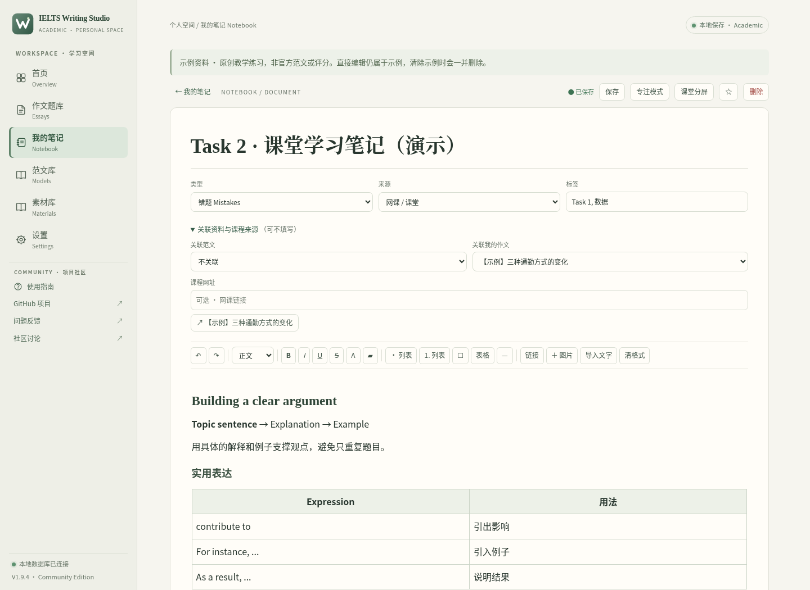
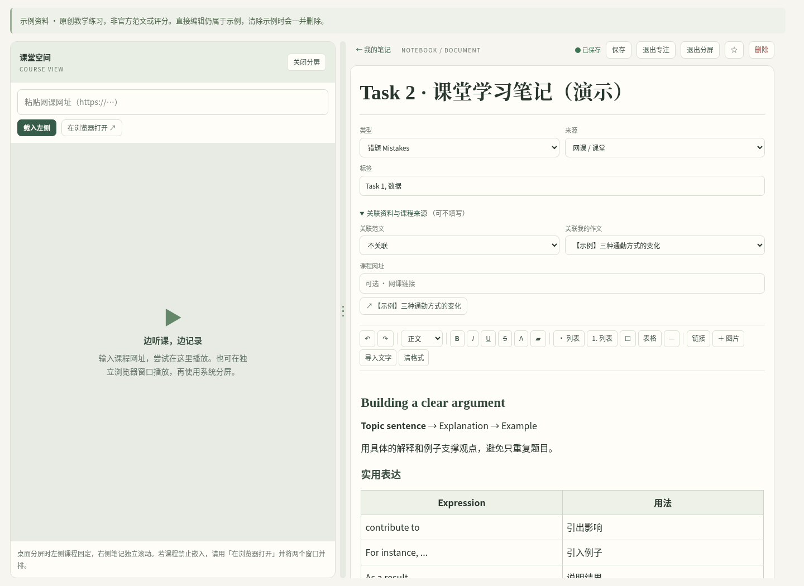
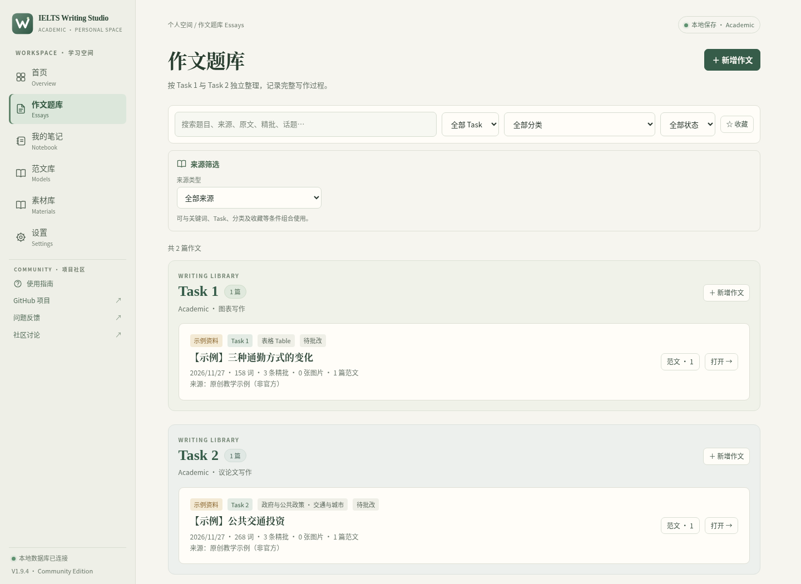
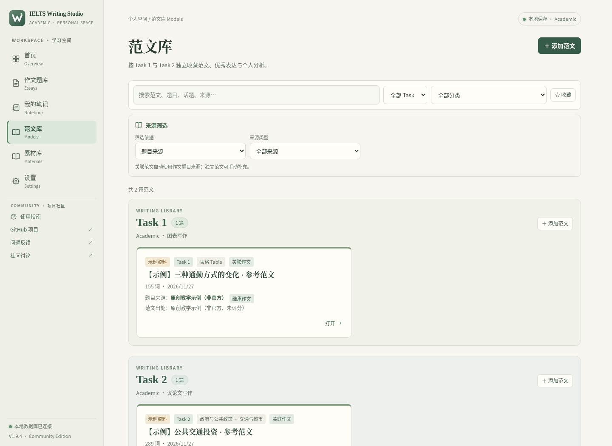
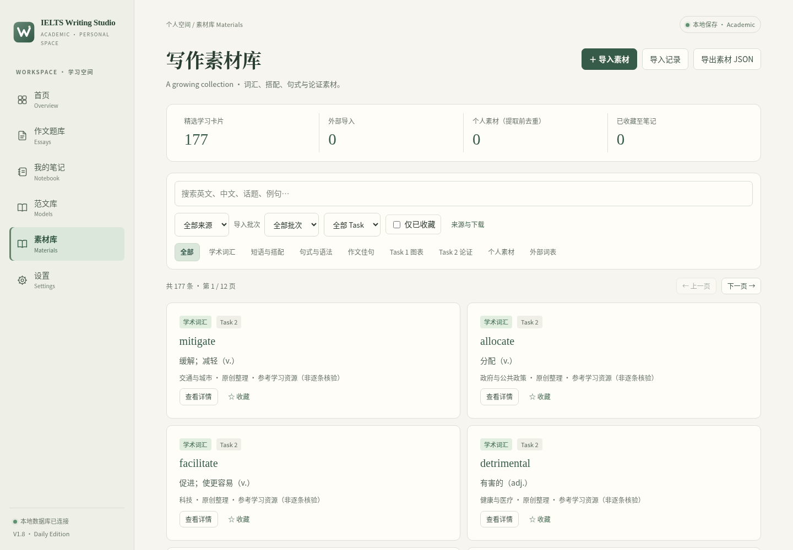
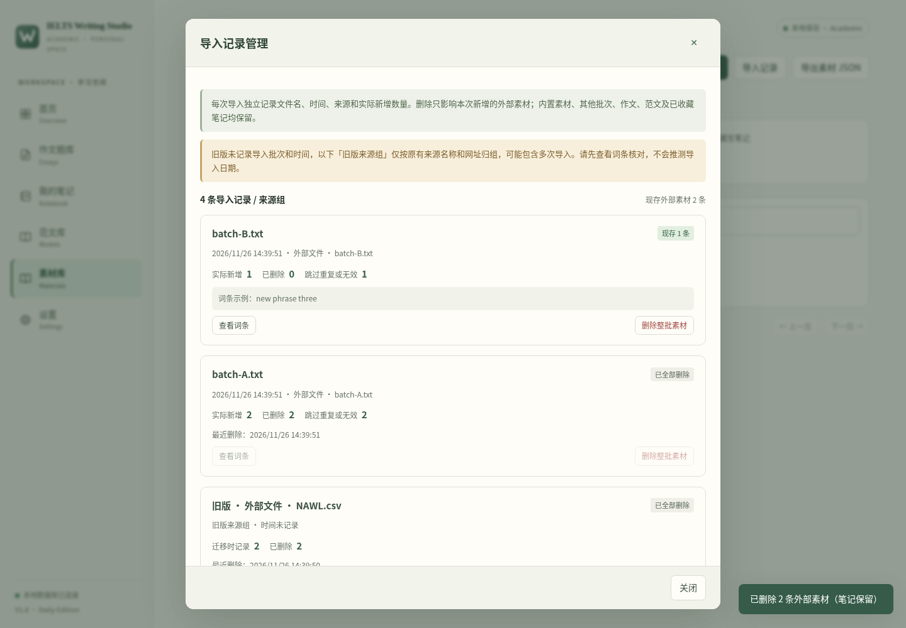

# IELTS Writing Studio · 雅思写作工作台

**Write. Reflect. Improve.**  
每一次写作，都是一次积累。

一个免费的、本地优先的 IELTS Academic 写作与课堂学习空间。  
A free, local-first workspace for IELTS Academic writing, note-taking and classroom learning.

`v1.9.4-beta` · `Public Beta` · `Local-first` · `No Login`

**[在线体验 · Live Demo](https://2b9zmbnpsh-afk.github.io/ielts-writing-studio/)** &nbsp;|&nbsp; **[下载离线版 · Download](https://github.com/2b9zmbnpsh-afk/ielts-writing-studio/releases)** &nbsp;|&nbsp; [版本发布 · Releases](https://github.com/2b9zmbnpsh-afk/ielts-writing-studio/releases)

---

*学术书房风格 · Academic Edition | V1.9.4 演示工作区。*

## 关于项目 · About

备考雅思时，作文原文、批改记录、范文、词汇、网课内容和个人笔记常常散落在不同的文件和工具中。IELTS Writing Studio 希望把这些内容放进一个统一、安静而有条理的学习空间，让每一篇作文、每一堂课都成为下一次写作的积累。

项目专注于写作练习、反馈整理、课堂记录与长期语言积累，不要求注册账号，不需要订阅，也不依赖应用后端。当前界面以中文为主，学习材料包含中英文内容。

> 听课与学习 → 写作练习 → 整理精批 → 修改与反思 → 收藏表达 → 持续复习 → 下一次写作

## V1.9.4 · Notebook & Classroom Edition

本次版本汇总 V1.9.0 至 V1.9.4 的改进，将个人笔记扩展为独立的文档式学习空间，并优化课堂分屏、表格编辑、导航布局及写作资料分类。

### 文档式笔记 · Rich-text Notebook

- 像使用 Word 一样直接编辑笔记正文，无需手动编写 Markdown；支持标题、粗体、斜体、下划线、删除线、高亮、列表、引用、链接和表格。
- 支持截图粘贴、本地图片导入、拖拽图片及图文混排；图片可通过手柄等比例缩放。
- 支持粘贴兼容的富文本、导入 TXT / Markdown、自动保存及单篇笔记 HTML 导出。
- 笔记可独立创建，也可按需关联范文、自己的作文及课程网址；支持自由记录、课堂笔记、范文学习和作文复盘。

### 课堂分屏 · Classroom Split View

- 左侧尝试加载课程网页，右侧直接编辑笔记；拖动中间分隔线可以调整两侧宽度。
- 桌面分屏时课程区域保持固定，笔记区域可独立滚动，编辑工具栏吸顶。
- 专注模式隐藏导航，适合与网课浏览器窗口并排使用。
- 部分课程平台不允许嵌入、需要登录或限制播放。此时可在独立浏览器窗口打开课程，使用系统或浏览器分屏。本项目不提供课程内容，也不绕过平台限制。

### 表格精细调整 · Word-style Table Editing

鼠标移到表格行列边界时，可通过双向箭头直接拖动调整列宽与行高，也支持整体尺寸调整。图片及表格尺寸随笔记保存；最小行高受内容限制，复杂合并单元格仍需进一步测试。

### 分类与交互 · Organized Workspace

- 作文题库与范文库分别展示 Task 1 和 Task 2 板块，按原有类型自动归类，独立统计数量，并支持从对应板块新增。
- 保留原有搜索、分类与收藏等筛选功能。
- 桌面导航采用固定宽度布局，常规页面不再出现左侧独立滚动条；窄屏保留响应式布局。
- 对显式删除操作增加确认保护，包括作文、范文、笔记、素材、图片与表格等；清空工作区另有确认流程。正常文本编辑不要求逐字确认。

详细版本历史：[V1.9.4 Changelog](CHANGELOG-v1.9.4.md) · [历史日志](CHANGELOG.md)

## 核心功能 · Features

| 模块 | 你可以做什么 |
| --- | --- |
| 作文题库 · Essays | 按 Task 1 / Task 2 独立管理作文、题目图片、话题分类与剑雅来源信息。 |
| 逐句精批 · Review | 保存原文、导入逐句反馈、对照修改前后表达、整理整体评价和修改版本。 |
| 范文库 · Models | 按 Task 1 / Task 2 收藏和筛选范文，并关联自己的作文或学习笔记。 |
| 个人笔记 · Notebook | 使用富文本编辑器自由记录知识点，插入图片、表格，调整尺寸，按需关联作文或范文。 |
| 课堂学习 · Classroom | 加载兼容的课程网页，左右可调分屏、专注记录和自动保存。 |
| 每日写作积累 · Daily Notes | 按日期轮换词汇、搭配、句式、佳句、图表表达及论证素材；支持分类、手动切换与收藏。 |
| 写作素材库 · Materials | 浏览 177 条内置学习卡片；支持 JSON、TXT、CSV 导入、搜索、筛选及独立导出。 |
| 导入管理 · Import History | 记录新导入批次，支持外部词条单独删除与整批删除；保留内置素材和已收藏到笔记的内容。 |
| 使用指南与示例 · Help & Demo | 首次使用引导、六个帮助章节、可选原创示例及一键清除、社区入口。 |
| 本地备份 · Backup | 导出完整 JSON 工作区备份，并在需要时恢复。 |

## 使用指南与原创示例 · Help & Demo

V1.8.1 Community Edition 引入的使用指南、社区反馈入口与原创演示资料继续保留。

**首次体验：** 打开使用指南 → 加载示例资料，即可查看两篇作文、每篇三条示例精批、修改稿、对应参考范文和五条笔记。示例为原创教学内容，Task 1 数据为虚构，不是官方真题或评分。清除示例会删除带标记的示例记录（包括直接编辑），独立创建的个人资料保留，指向被删除示例的关联会解除。

## 界面预览 · Screenshots

### 文档式笔记 · Rich-text Notebook

### 课堂分屏 · Classroom Split View

*课堂区域尚未加载外部课程，展示分屏布局及演示笔记。*

### 作文题库 · Essays

### 范文库 · Models

*以上新版截图由 V1.9.4 实际页面渲染生成，使用模拟存储与原创演示资料，不含真实个人学习数据。*

### 写作素材库 · Materials Library

将词汇、短语、句式和写作思路组织成可搜索的学习卡片，按需收藏至个人笔记。外部词表与精选学习素材分开管理。

### 导入记录 · Import History

每次新导入都有独立记录，方便管理不同来源的素材。旧版未记录批次的素材只能按来源归组，无法还原真实导入时间或批次。

*素材库与导入记录图片为 V1.8 历史界面；使用指南及精批图为 V1.8.1 历史界面。所有截图均使用演示资料，不含真实个人学习记录。*

## 开始使用 · Getting Started

### 在线使用（推荐）

打开 **[IELTS Writing Studio](https://2b9zmbnpsh-afk.github.io/ielts-writing-studio/)** 即可开始，无需安装或注册。建议使用更新后的 Chrome 或 Edge 普通窗口。

### 离线使用

1. 在 [版本发布页面](https://github.com/2b9zmbnpsh-afk/ielts-writing-studio/releases) 中选择所需版本，在 Assets 下载 `index.html`（以实际已发布版本为准）。
2. 使用浏览器打开文件。课堂网页及外部参考链接仍需要网络连接。
3. 如浏览器限制本地文件的数据库存储，请使用在线版，并确认页面显示本地数据库已连接。

### 第一次写作练习

1. 从首页或作文题库新增一篇 Task 1 或 Task 2 作文，录入题目和原文。
2. 在作文详情中复制精批指令，交给你自行选择的外部 AI 工具处理（如需）。
3. 按网页提示的格式导入反馈，查看逐句修改、整体评价和优化表达。
4. 将值得复习的错误或表达收藏到个人笔记，结合每日积累持续练习。
5. 定期进入设置，导出完整 JSON 备份。

### 第一次课堂笔记

1. 进入「我的笔记」，点击「开始课堂笔记」；也可以从已有笔记打开「课堂分屏」。
2. 输入课程网址，点击「载入左侧」。如平台不支持嵌入，使用「在浏览器打开」，将课程窗口与笔记窗口并排。
3. 在笔记正文中直接输入、粘贴截图或导入本地图片；拖动图片或表格手柄调整尺寸。
4. 根据需要调整中间分隔线，开启专注模式，或关联范文与自己的作文。
5. 确认保存状态，定期导出笔记或完整工作区备份。

**本网页是写作资料管理和反馈学习工具，不内置 AI 自动批改服务，也不提供官方雅思评分。** 外部 AI 服务可能有独立的账号、费用及隐私规则。

## 数据与隐私 · Privacy First

- 作文、图片、精批、范文、富文本笔记及导入素材保存在当前浏览器的 IndexedDB 中，不会自动上传到项目仓库，也不会自动跨设备同步。
- 在线版、离线版、不同浏览器或设备的数据库可能彼此独立。迁移或升级前先导出旧工作区备份，再在需要时恢复。使用相同在线地址及浏览器时，仍建议备份后检查原数据是否保留。
- 恢复备份会替换当前工作区；清除站点数据、隐私浏览或浏览器存储回收可能导致记录丢失。请定期备份，并避免同时在多个标签页编辑同一工作区。
- 笔记中的本地导入图片也会占用浏览器存储空间并增加备份文件体积。删除确认并不等于回收站或永久备份。
- 加载外部课程网页或打开外部资源时，浏览器会与相关服务通信；其登录、Cookie、网络请求、播放权限及隐私规则由对应平台管理。
- GitHub Pages 托管服务及外部资源网站适用各自的隐私政策。本地存储不是加密保险库，也不是永久备份。

更多细节：[V1.9.4 隐私说明 · Privacy Notice](PRIVACY-v1.9.4.md) · [旧版隐私说明](PRIVACY.md)

## 学习素材 · Learning Materials

V1.8 引入的 177 条原创整理学习卡片继续保留，覆盖学术词汇、固定搭配、句式与语法、作文佳句、Task 1 图表表达及 Task 2 论证素材。

这些素材附有学习参考入口，但并非逐条经来源网站核验的语料，也不是官方高分范文。图表例句为练习示意，论证链为写作思路而非经证实的研究结论。完整第三方词表并未预装；用户可按原始授权自行导入。

更多细节：[素材来源与使用说明 · Materials](MATERIALS.md)

## 参与建设 · Feedback & Community

目前项目处于公开测试阶段，欢迎正在备考雅思的同学分享真实使用体验。

| 如果你想…… | 请前往 |
| --- | --- |
| 报告程序错误或素材问题 | [GitHub Issues](https://github.com/2b9zmbnpsh-afk/ielts-writing-studio/issues) |
| 提出功能建议或交流学习体验 | [GitHub Discussions](https://github.com/2b9zmbnpsh-afk/ielts-writing-studio/discussions) |
| 查看更新与下载历史版本 | [Releases](https://github.com/2b9zmbnpsh-afk/ielts-writing-studio/releases) · [V1.9.4 Changelog](CHANGELOG-v1.9.4.md) · [历史日志](CHANGELOG.md) |

反馈问题时，建议说明设备、浏览器、操作步骤、预期结果和实际结果。可参考 [反馈模板](feedback-example.md)。请不要在公开反馈区上传完整个人作文、数据备份、真题扫描件、密钥或含个人信息的截图。

如果这个工具对你的备考有帮助，欢迎在 GitHub 点亮 Star，或分享给有需要的同学。

## 项目技术 · Technology

HTML · CSS · Vanilla JavaScript · IndexedDB · GitHub Pages

单文件应用，无需构建工具或应用后端。V1.9.4 仍处于公开测试阶段。开发过程已进行 JavaScript 语法检查及 Chromium 模拟存储交互测试；真实 IndexedDB 长期持久化、跨浏览器、复杂表格、第三方课程兼容性及素材授权仍需进一步确认。

后续优先完善真实数据备份与恢复测试、跨浏览器兼容性、富文本编辑体验和课程分屏稳定性。

## 声明与许可 · Disclaimer & License

本项目是非官方独立学习工具，与 IELTS 官方机构无隶属关系，内置示例不代表官方范文或评分认证。

项目源码目前公开，但尚未选择开源许可证；公开可见不等于授权任意修改、再分发或商业使用。第三方材料须遵守各自的权利与许可。公开测试版可能存在错误，请勿将本工具作为唯一的学习数据存储位置。

---

**Read deeply. Write clearly. Grow daily.**

日有所学，日有所积。

[在线体验](https://2b9zmbnpsh-afk.github.io/ielts-writing-studio/) · [反馈建议](https://github.com/2b9zmbnpsh-afk/ielts-writing-studio/issues) · [下载版本](https://github.com/2b9zmbnpsh-afk/ielts-writing-studio/releases)

